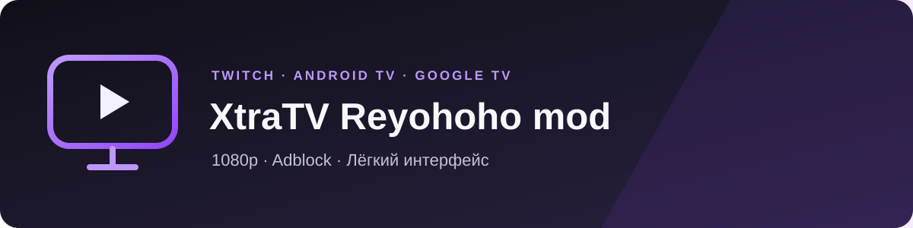

<p align="center"></p>
<p align="center"><strong>Twitch для Android TV и Google TV — 1080p, adblock и меньше лишнего.</strong></p>
<p align="center">


</p>

## Что изменено

| | В модификации |
|---|---|
| **1080p в РФ** | Встроен [ReYohoho Twitch Proxy](https://github.com/reyohoho/twitch_quality_proxy). Для штатных адресов собственный VPS не нужен. |
| **Adblock** | Сохранена блокировка рекламы Xtra TV с подменой видеопотока. |
| **Чат вручную** | Эфир открывается без чата. Чат подключается при открытии и отключается при закрытии. |
| **Легче для ТВ** | Нет видеопревью, анимации смайлов и пружинного масштабирования строк меню. |
| **Меньше лишнего** | Удалены загрузки, импорт локальных видео, офлайн-просмотр и переводчик ML Kit. PiP и мультистрим отключены. |
| **Отдельные APK** | ARMv7, ARM64, x86, x86_64 — каждый файл содержит только свою архитектуру. |

## Возможности приложения

- **Twitch на телевизоре:** популярные эфиры, категории, каналы, подписки и главная с подборками.
- **Управление пультом:** крупные карточки, заметный фокус, навигация крестовиной.
- **Поиск:** текстовый и голосовой; сортировка, фильтры и сохранённые фильтры.
- **Плеер:** выбор качества, только звук, онлайн-VOD и клипы, перемотка и DVR при доступности записи эфира.
- **Аккаунт и закладки:** вход в Twitch, подписки на каналы, сохранение видео в закладки; локальные подписки без входа.
- **Чат:** сообщения, сторонние смайлы, настройка положения и размера панели. При старте скрыт и не подключён.

> Качество зависит от канала и доступности внешнего сервиса ReYohoho; adblock может требовать обновлений после изменений Twitch. На TCL проверено 1080p60. Остальные устройства требуют отдельной проверки; задержки интерфейса ещё исследуются.

## Установка

После публикации выбирайте **один APK** в **Releases этого репозитория**:

| Android на устройстве | Окончание файла |
|---|---|
| ARMv7, 32-бит | `-armeabi-v7a.apk` |
| ARM64, 64-бит | `-arm64-v8a.apk` |
| x86, 32-бит | `-x86.apk` |
| x86_64, 64-бит | `-x86_64.apk` |

Архитектура ОС важнее разрядности процессора: проверенный TCL использует ARMv7. Узнать архитектуру: `adb shell getprop ro.product.cpu.abilist`. Разрешите установку APK выбранному файловому менеджеру и откройте файл.

Мод устанавливается отдельно от оригинального Xtra TV. Проверка обновлений оригинального клиента отключена; обновления мода устанавливаются из его Releases.

## Сборка

JDK 21 · Android SDK 37. Например, отдельный тестовый APK для ARM64:

```sh
./gradlew :app:testDebugUnitTest :app:assembleOptimized -PtargetAbi=arm64-v8a
```

Результат: `app/build/outputs/apk/optimized/app-optimized.apk`. По умолчанию — ARMv7. Actions собирает четыре отдельных файла. Тестовая сборка использует публичный ключ разработки; для публикации нужен свой ключ. [Подпись и выпуск →](docs/build-and-release.md)

## Основа

[Xtra TV / XtraATV](https://github.com/razeNFR/XtraATV) → [Xtra](https://github.com/crackededed/Xtra) → [AndreyAsadchy/Xtra](https://github.com/AndreyAsadchy/Xtra). Прокси: [ReYohoho](https://github.com/reyohoho/twitch_quality_proxy). Adblock: [TwitchAdSolutions / VAFT](https://github.com/pixeltris/TwitchAdSolutions).

**[GNU AGPL v3.0](LICENSE)**. При распространении APK предоставляйте соответствующий исходный код. Неофициальный клиент, не связанный с Twitch.
